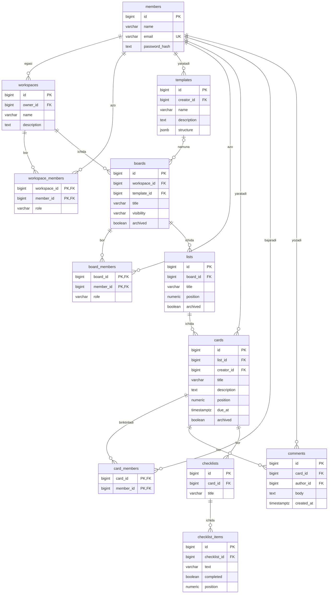

# Trello ma’lumotlar bazasi

Bu chizma Trello kabi vazifalar boshqariladigan dastur uchun tuzilgan. Unda 12 ta jadval bor.

## Asosiy jadvallar

- `members` — foydalanuvchilar.
- `workspaces` — jamoaning ish joylari.
- `boards` — loyiha doskalari.
- `lists` — doskadagi bo‘limlar, masalan “Bajarish kerak” va “Tayyor”.
- `cards` — vazifalar.
- `templates` — yangi doska uchun tayyor namunalar.
- Qolgan jadvallar a’zolar, izohlar va vazifa ichidagi ro‘yxatlarni saqlaydi.

## Belgilar

- `PK` — yozuvning asosiy raqami.
- `FK` — boshqa jadvaldagi yozuvga bog‘lanish.
- `UK` — takrorlanmaydigan qiymat.
- `bigint` — butun son, `varchar` va `text` — matn.
- `boolean` — ha yoki yo‘q, `numeric` — son.
- `timestamptz` — sana va vaqt, `jsonb` — tuzilgan ma’lumot.

## Chizma

## Bog‘lanishlar qanday ishlaydi?

Ish joyida bir nechta doska, doskada bir nechta bo‘lim, bo‘limda esa bir nechta vazifa bo‘ladi. Har bir vazifaga a’zolar, izohlar va bajariladigan ishlar ro‘yxati qo‘shiladi.

`workspace_members`, `board_members` va `card_members` jadvallari foydalanuvchini tegishli ish joyi, doska yoki vazifaga bog‘laydi. Ularning ikki ustuni birgalikda asosiy kalit bo‘ladi. Shu sabab bir a’zo ikki marta yozilmaydi.

Doska tayyor namunadan yaratilishi mumkin, lekin bu majburiy emas. Namuna o‘zgarsa, avval yaratilgan doska o‘zgarmaydi. `position` maydoni bo‘lim va vazifalar tartibini saqlaydi.

Doska a’zosi ish joyiga ham kirish huquqiga ega bo‘lishi kerak. Vazifaga faqat shu doska a’zosi biriktiriladi. Bular dasturda yoki baza qoidalari orqali tekshiriladi.

Email kichik harflarda saqlanadi va takrorlanmaydi. Ish joyi egasini o‘chirishdan oldin egalik boshqa a’zoga o‘tkaziladi. Ichki yozuvlar uchun o‘chirish qoidalari belgilanadi; muallif haqidagi ma’lumotni saqlash kerak bo‘lsa, foydalanuvchi faqat faol emas deb belgilanadi.

Tez qidirish uchun bog‘lanish ustunlariga indeks qo‘shiladi. Yaratilgan va o‘zgartirilgan vaqtlarni ham saqlash tavsiya etiladi.

Chizmaning alohida nusxasi `diagram.svg`, Mermaid matni esa `diagram.mmd` faylida.
