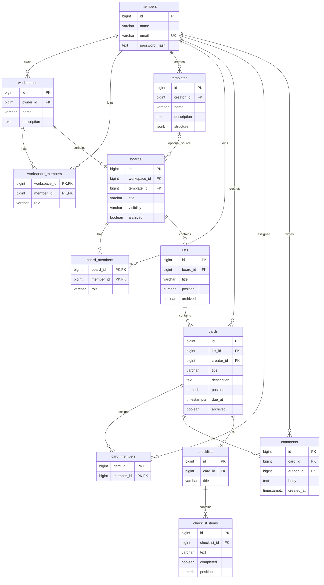

# Trello database ER diagram

PostgreSQL types; PK = primary key, FK = foreign key, UK = unique. Composite PKs on membership tables prevent duplicate memberships. IDs use generated identity bigint. JSONB template structure is a reusable snapshot, copied into boards/lists/cards when instantiated; later edits do not mutate existing boards.

## Relations and integrity
- Workspace owner → members.id. Workspace membership and board membership use join tables with role CHECK (`owner`, `admin`, `member`, `observer` as appropriate).
- Board belongs to one workspace; optional template_id uses ON DELETE SET NULL. Membership in a board must also be permitted by its workspace; enforce this in the service transaction or a database trigger.
- List belongs to board. Card belongs to list, so board/workspace are derived without redundant foreign keys. `position` controls ordering; reorder in a transaction.
- Members may be assigned to many cards. Card assignees must be board members; service/trigger validates this. Comments reference author and card.
- Checklists and checklist items belong to cards through their parents.
- ON DELETE CASCADE for contained lists/cards/comments/checklists/memberships. RESTRICT deletion of workspace owner; transfer ownership first. Soft-delete members when attribution must remain.
- Add created_at/updated_at timestamps to mutable entities. Index all FK columns, cards(due_at), lists(board_id,position), cards(list_id,position), comments(card_id,created_at).
- email is normalized to lowercase before unique validation; role/visibility values are checked. Visibility is private/workspace/public.

Required domains: Workspaces, Boards, Members, Cards, Lists and Templates are all included. diagram.svg is a standalone visual; README Mermaid shows the exact FK relationship graph.
